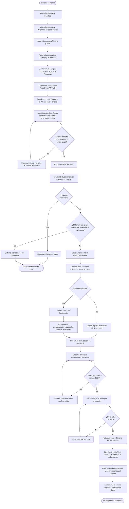

# Diagrama de Actividades — Flujo académico completo de un semestre

Recorre de punta a punta el ciclo que conecta a los 4 roles: desde que el Administrador crea la estructura académica hasta que el Estudiante consulta sus resultados finales. Corresponde a los sprints 1 a 6 del plan ágil (`docs/scrum/`) ejecutados en secuencia sobre un mismo periodo académico.

**Nota:** cada rechazo del diagrama (choque de horario, sin cupo, porcentaje distinto de 100%, nota fuera de rango) corresponde a una regla de negocio con prueba automatizada en `server/tests/api.test.ts` y, cuando aplica, a una restricción a nivel de base de datos (ver `docs/analysis/reglas_de_negocio.md`).
