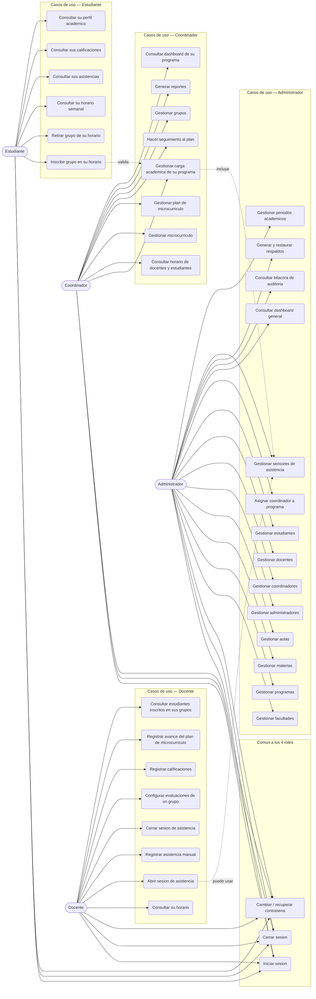

# Diagrama de Casos de Uso — Sistema Académico Universitario

Representa los cuatro actores del sistema (roles de autenticación) y sus casos de uso principales, agrupados por rol. Mermaid no soporta de forma estable la notación UML de casos de uso nativa en todos los renderizadores; se usa un `flowchart LR` con los actores como nodos rectangulares y los casos de uso como nodos ovalados (`(( ))` / `([ ])`), agrupados en subgrafos por rol.

## Casos de uso no obvios (aclaración)

- **Asignar coordinador a programa (ua9):** no es una acción del coordinador sobre sí mismo; la ejecuta el Administrador. El sistema cierra automáticamente la asignación vigente anterior (índice único parcial `coordinador_vigente_por_programa`), de modo que un programa siempre tiene a lo sumo un coordinador activo.
- **Gestionar sensores de asistencia (ua13) / ud2 "puede usar":** en la implementación, el registro de asistencia por sensor es un simulador: un usuario con permisos (ADMINISTRADOR o DOCENTE) dispara la lectura desde la interfaz como si fuera el dispositivo físico. No existe un actor "Sensor" separado porque el hardware no está conectado; el caso de uso lo inicia una persona, no un dispositivo.
- **ue1 "valida" uc1:** la inscripción del estudiante en un grupo depende de que exista una carga académica (uc1) asignada a ese grupo; sin carga académica, el grupo no tiene horario y la inscripción se rechaza.
- **Consultar estudiantes inscritos en sus grupos (ud8):** requisito explícito del enunciado para el rol Docente, usado también como paso intermedio del caso de uso "Registrar asistencia manual" (ud3), ya que el formulario de asistencia se arma a partir de la lista de inscritos.
- **Gestionar periodos académicos (ua14):** no estaba en la lista original de endpoints del documento maestro, pero es un prerrequisito de todos los demás módulos académicos (grupos, carga académica, calificaciones, reportes), por lo que se agregó como caso de uso propio del Administrador.
