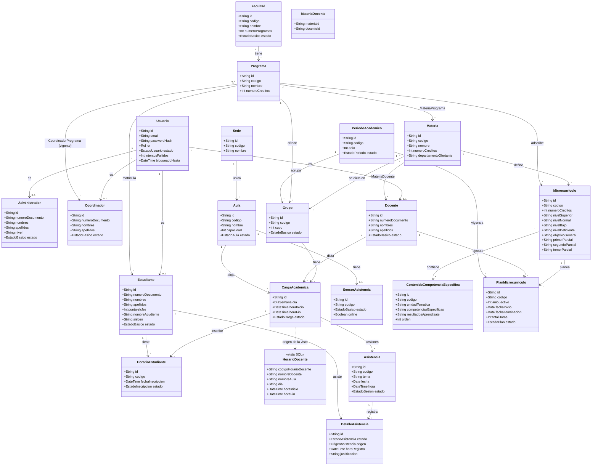

# Diagrama de Clases — Sistema Académico Universitario

Refleja las 18 clases del documento original **tal como quedaron implementadas** en `server/prisma/schema.prisma` (40 modelos en total; aquí se muestran las 18 originales más las entidades de apoyo indispensables para entenderlas: `Usuario`, `Grupo`, `PeriodoAcademico`, `Sede`). Los atributos se simplificaron a los más representativos; el esquema real tiene además columnas de auditoría (`creadoEn`, `actualizadoEn`) en casi todas las tablas, omitidas aquí por brevedad.

## Diferencias respecto al documento original (y por qué)

> Cada nota corresponde a una decisión documentada en `docs/analysis/decisiones_arquitectonicas.md` (ADR) y `docs/analysis/reglas_de_negocio.md`.

- **`HorarioDocente` no es una tabla, es una vista SQL** (`CREATE VIEW horario_docente`) calculada sobre `CargaAcademica` + `Docente` + `Grupo` + `Materia` + `Aula`. El documento original la describe como una clase con los mismos atributos que `CargaAcademica` (`IdDocente`, `NombreDocente`, `NombreAula`, `Hora`, `Grupo`, `Dia`, `CodigoMateria`, `NombreMateria`); duplicarla como tabla habría exigido mantenerla sincronizada manualmente ante cada cambio de horario, con riesgo de inconsistencia. Al ser una vista, siempre refleja el estado actual de `cargas_academicas` sin trabajo adicional.
- **`Estudiante` no duplica `NombreFacultad` ni `NombrePrograma`** como lista el documento original: se relaciona con `Programa`, y la facultad se deriva transitivamente (`Estudiante → Programa → Facultad`). Lo mismo aplica a `PlanMicrocurriculo`, que no guarda `NombreDocente`/`Correo`/`Facultad` por separado: se derivan de sus relaciones con `Docente` y `Programa`.
- **`CargaAcademica` no se identifica por `CodigoPrograma`/`CodigoMateria` como en el documento**, sino por una relación a `Grupo` (que a su vez referencia `Materia` y `Programa`). Esto permite que una misma combinación materia-programa-periodo tenga varios grupos paralelos, algo que el documento original no distinguía explícitamente pero que es una necesidad real de cualquier institución.
- **`MateriaDocente` y la relación materia-programa (`MateriaPrograma`) son tablas de unión explícitas** porque el documento ya anticipaba que "una materia puede ser impartida por diferentes docentes" y "puede estar asociada a distintos programas" (relaciones muchos-a-muchos).
- Entidades que el documento original no contemplaba pero que resultaron indispensables para implementar lo que sí pedía: `Usuario` (autenticación separada de los datos de la persona, para no mezclar credenciales con datos académicos), `Grupo` (unidad real de inscripción del estudiante), `PeriodoAcademico` y `Sede`.
