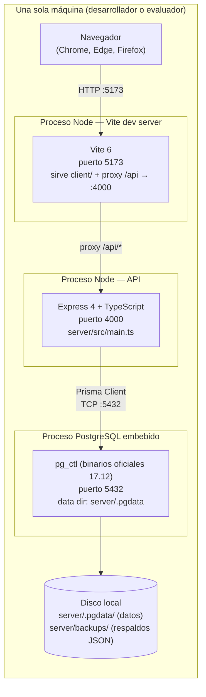
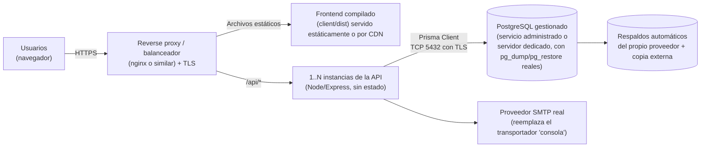

# Diagrama de Despliegue — Sistema Académico Universitario

## Despliegue actual (desarrollo local, el que realmente corre hoy)

El proyecto fue diseñado para ejecutarse en una sola máquina **sin instalar PostgreSQL ni Docker** y **sin permisos de administrador** (ver ADR correspondiente en `docs/analysis/decisiones_arquitectonicas.md`): usa binarios oficiales de PostgreSQL 17 descargados por npm (`embedded-postgres`) y gestionados con `pg_ctl` directamente.

Para producción local (`npm run build && npm start`), `NodeProc1` desaparece: el frontend se compila a archivos estáticos y Express podría servirlos directamente, o se despliegan por separado como en la alternativa de abajo.

## Alternativa sugerida para un despliegue real en producción (no implementada en este proyecto)

Si la institución necesitara exponer el sistema en internet para varios usuarios concurrentes, la recomendación — **no construida en esta sesión, solo documentada como siguiente paso** — sería:

Diferencias clave frente al entorno actual:

- PostgreSQL embebido (un solo proceso, pensado para desarrollo sin privilegios) se reemplaza por un **PostgreSQL gestionado o dedicado**, que sí trae `pg_dump`/`pg_restore` nativos — el respaldo lógico en TypeScript (`server/src/modules/respaldos`) dejaría de ser necesario, aunque podría conservarse como respaldo adicional de aplicación.
- La API pasaría de un proceso único a **N instancias sin estado** detrás de un balanceador, ya que la autenticación es JWT (no depende de sesión en memoria).
- El transportador de correo "consola" (`EMAIL_TRANSPORT=console`) se reemplazaría por un proveedor SMTP real, cambiando solo una variable de entorno y la función `enviarPorSmtp()` ya prevista en `email.service.ts`.
- Se agregaría TLS/HTTPS en el borde (reverse proxy), que hoy no es necesario porque todo corre en `localhost`.
