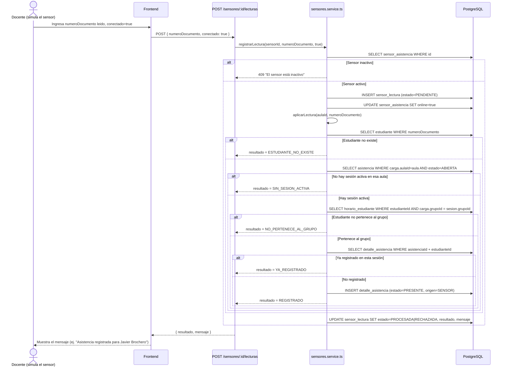
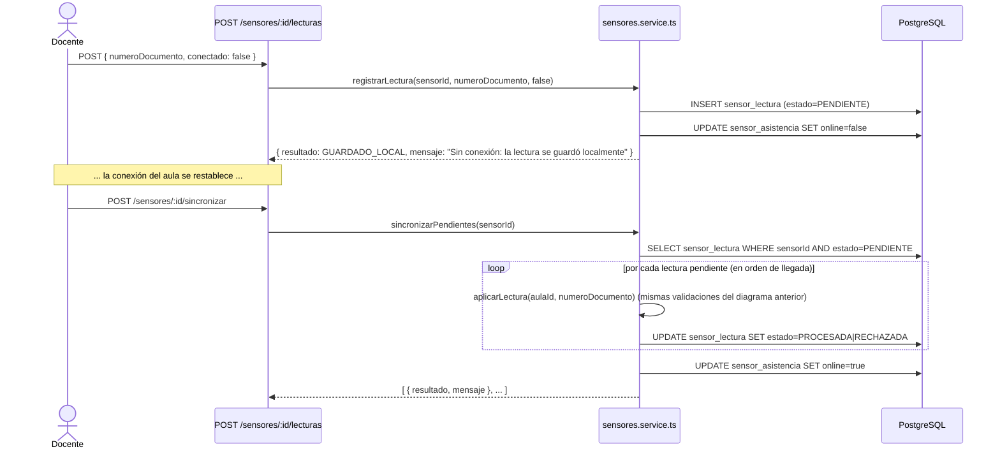

# Diagrama de Secuencia — Registro de asistencia con el sensor (HU-13, CP-03)

Basado en `server/src/modules/sensores/sensores.service.ts` (`registrarLectura`, `aplicarLectura`, `sincronizarPendientes`). El sensor físico no está conectado: el simulador expone `POST /api/sensores/:id/lecturas { numeroDocumento, conectado }`, que una persona autorizada (ADMINISTRADOR o DOCENTE) dispara desde la interfaz haciendo de "lectura del dispositivo".

## Lectura con conexión (camino feliz y los tres rechazos posibles)

## Lectura sin conexión y sincronización posterior (R-01, alerta A-01)

**Relación con el riesgo R-01 y la alerta A-01** (`docs/scrum/analisis_riesgos.md`): si el sensor pierde la red durante 5 minutos en horario de clase, el docente tiene como respaldo el registro manual (`POST /asistencias/:id/detalles`, ver módulo `asistencias`), que usa las mismas reglas de pertenencia al grupo pero con `origen=MANUAL` en vez de `SENSOR`.
