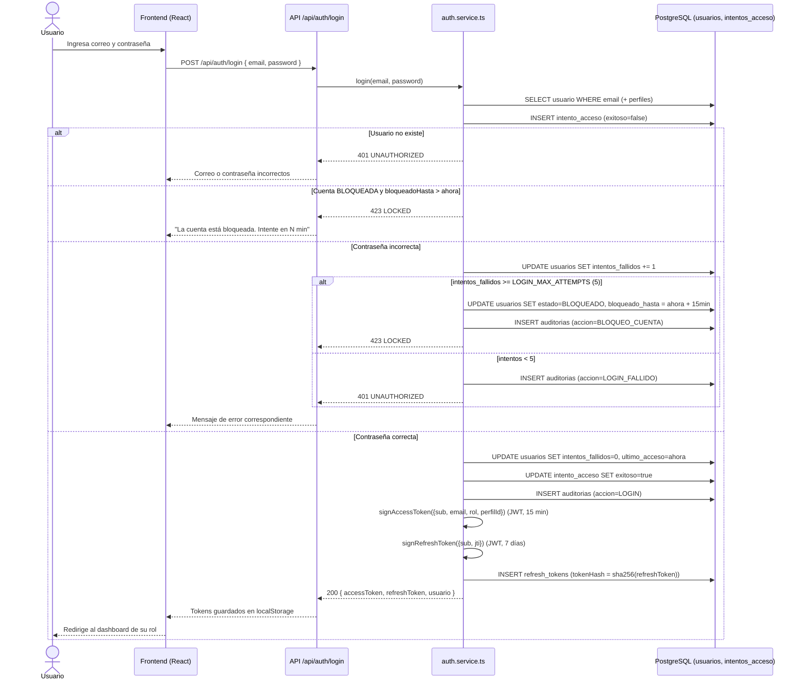
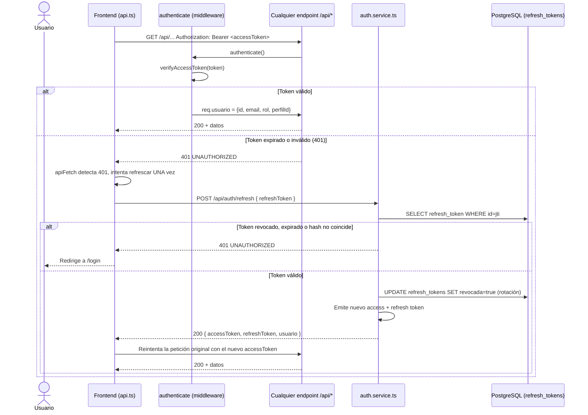

# Diagrama de Secuencia — Autenticación y bloqueo de cuenta (HU-01, CP-01)

Basado en la implementación real de `server/src/modules/auth/auth.service.ts` (`login`, `refrescarSesion`) y `server/src/middleware/auth.ts`.

## Camino feliz + intento fallido + bloqueo

## Petición autenticada y renovación automática (refresh)

**Nota de implementación:** el acceso por rol (`requireRole`) no vuelve a consultar la base de datos en cada petición — el rol y el `perfilId` ya viajan dentro del access token firmado. El estado de la cuenta (bloqueo, inactivación) solo se revalida en `login` y `refresh`, que es donde puede cambiar; esto evita una consulta extra a `usuarios` en cada endpoint protegido sin sacrificar seguridad, porque un token comprometido deja de ser válido en como máximo 15 minutos (`JWT_ACCESS_TTL`).
