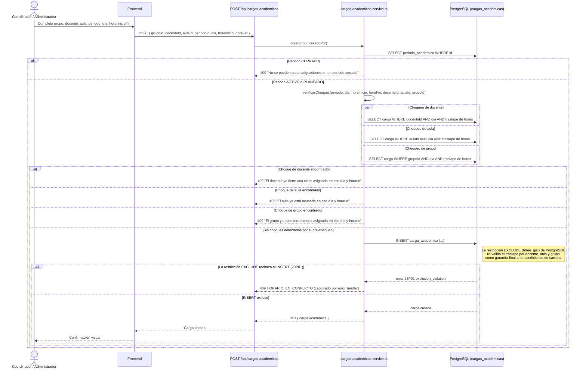

# Diagrama de Secuencia — Carga académica sin choques (HU-09, CP-02)

Basado en `server/src/modules/cargas-academicas/cargas-academicas.service.ts` (`crear`, `verificarChoques`) y en la migración `20261124173500_integridad_y_reglas_de_negocio` (restricciones `EXCLUDE` con `btree_gist` sobre `cargas_academicas`). La validación ocurre en **dos capas independientes**: un pre-chequeo en la API (da un mensaje específico) y una restricción `EXCLUDE` en PostgreSQL (garantía final ante condiciones de carrera, por si dos peticiones llegan al mismo tiempo).

## Caso concreto verificado (CP-02, probado en `tests/api.test.ts` y `scripts/_check.ts`)

| Caso | Entrada | Resultado |
|---|---|---|
| Base | Docente D1, Grupo G1, Aula A101, lunes 08:00–10:00 | ✅ Creada |
| A | Mismo docente D1, otro grupo/aula, lunes 08:00–10:00 | ❌ 409 — choque de docente |
| B | Otro docente D2, misma aula A101, lunes 08:00–10:00 | ❌ 409 — choque de aula |
| C | Docente D1, aula A101, lunes **10:00–12:00** (horas contiguas) | ✅ Creada — no hay traslape (`horaFin` del existente = `horaInicio` del nuevo) |

La condición de traslape usada tanto en el pre-chequeo como en la restricción `EXCLUDE` es la intersección estricta de intervalos (`horaInicio < otro.horaFin AND horaFin > otro.horaInicio`), por lo que dos clases contiguas (una termina exactamente cuando la otra empieza) **no** se consideran un choque — este es el comportamiento que exige el Caso C.
